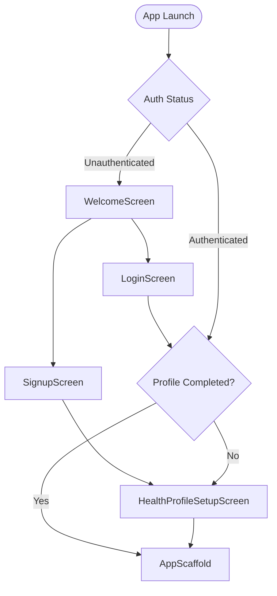

# HealthDevice Companion App — Technical Handoff Report

> **Document Type:** Technical Handoff & Architecture Audit  
> **Target Audience:** Incoming Software Engineers, Embedded Engineers, and AI Agents  
> **Generation Date:** 2026-09-30  
> **Operating System / Workspace:** Windows / `d:\SG\main files\healthdeviceapp`  
> **Handoff Mode:** 100% Factual / Zero Speculation / No Code Alteration

---

## 1. Project Overview

* **Flutter Version:** `3.47.5` (channel stable, engine `26a8d6...`)
* **Dart Version:** `3.13.4` (SDK constraint in `pubspec.yaml`: `>=3.13.4 <4.0.0`)
* **Project Name:** `healthdeviceapp`
* **Package / Application ID:** `com.example.healthdeviceapp`
* **Android Configuration:**
  * Build System: Gradle Kotlin DSL (`build.gradle.kts`) with Gradle `8.12`, Android Gradle Plugin (AGP) `8.9.1`, Kotlin `2.1.0`.
  * Compile SDK: `flutter.compileSdkVersion` (default 34/35)
  * Target SDK: `flutter.targetSdkVersion` (default 34)
  * Min SDK: `flutter.minSdkVersion` (default 21)
  * JVM Target: `JavaVersion.VERSION_17`
  * Android Manifest Permissions:
    * `android.permission.ACCESS_WIFI_STATE`
    * `android.permission.CHANGE_WIFI_STATE`
    * `android.permission.ACCESS_FINE_LOCATION`
    * `android.permission.ACCESS_COARSE_LOCATION`
  * Android Manifest Features: `android.hardware.wifi` (required: false)
  * Bluetooth Permissions: **NONE** declared in AndroidManifest.xml.
* **Windows Configuration:**
  * Native Runner: C++ Win32 desktop runner (`windows/runner/main.cpp`, `windows/runner/flutter_window.cpp`).
  * Target Windows OS: Windows 10+ standard desktop build (`healthdeviceapp.exe`).
  * Custom Native Plugins / Windows Platform Channels: **NONE**. Pure default runner.
* **Dependencies (`pubspec.yaml`):**
  * `dependencies`:
    * `flutter`: `sdk: flutter`
    * `cupertino_icons`: `^1.0.8`
  * `dev_dependencies`:
    * `flutter_test`: `sdk: flutter`
    * `flutter_lints`: `^6.0.0`
  * *Notable Absence:* Zero third-party packages for state management, networking, Bluetooth, SQLite, or cryptography.
* **State Management Approach:**
  * Standard Flutter reactive primitives: `ValueNotifier<T>` and `ValueListenable<T>`.
  * UI observes state via `ValueListenableBuilder<T>` and standard `StatefulWidget` local state (`setState()`).
  * Repositories (`HealthRepository`, `AuthRepository`) expose `ValueListenable` properties for reactive UI updates across screens.
* **Navigation Approach:**
  * Imperative standard Flutter navigation: `Navigator.push(MaterialPageRoute(...))` and `Navigator.pop(context)`.
  * Root navigation in `main.dart` is reactive: `MaterialApp` listens to `_auth.currentUser` and `_auth.currentProfile` via `ValueListenableBuilder` to conditionally display:
    1. `WelcomeScreen` (if unauthenticated)
    2. `HealthProfileSetupScreen` (if authenticated but profile uncompleted)
    3. `AppScaffold` (if authenticated and profile completed)
  * Main tabs are managed inside `AppScaffold` using an `IndexedStack` (4 tabs: Home, History, Device, Settings).
* **Storage / Persistence Approach:**
  * Local file-backed JSON key-value store implemented in `SettingsStorageService`.
  * Writes to a hidden JSON file: `.health_device_settings.json` located in `getApplicationSupportDirectory()` or `getApplicationDocumentsDirectory()` with fallback to working directory.
  * In-memory cache synced to disk on writes using standard `dart:convert` (`jsonEncode` / `jsonDecode`) and `dart:io` (`File`).

---

## 2. Complete Project Structure

### Source Code Hierarchy (`lib/`)

```
lib/
├── main.dart
├── models/
│   └── health_metrics.dart
├── repositories/
│   ├── auth_repository.dart
│   ├── health_repository.dart
│   └── mock_health_repository.dart
├── screens/
│   ├── about_screen.dart
│   ├── activity_detail_screen.dart
│   ├── ai_assistant_screen.dart
│   ├── alarms_screen.dart
│   ├── button_guide_screen.dart
│   ├── device_info_screen.dart
│   ├── device_screen.dart
│   ├── display_settings_screen.dart
│   ├── health_profile_setup_screen.dart
│   ├── heart_rate_detail_screen.dart
│   ├── history_screen.dart
│   ├── home_screen.dart
│   ├── led_settings_screen.dart
│   ├── login_screen.dart
│   ├── notifications_screen.dart
│   ├── profile_screen.dart
│   ├── reminders_screen.dart
│   ├── settings_screen.dart
│   ├── signup_screen.dart
│   ├── sound_settings_screen.dart
│   ├── spo2_detail_screen.dart
│   ├── welcome_screen.dart
│   └── wifi_settings_screen.dart
├── services/
│   ├── ai_service.dart
│   ├── settings_storage_service.dart
│   └── wifi_scanner_service.dart
├── theme/
│   └── app_theme.dart
└── widgets/
    ├── app_scaffold.dart
    ├── connection_status_header.dart
    ├── custom_charts.dart
    ├── metric_card.dart
    └── rgb_color_picker.dart
```

### Detailed File Catalog

#### Core & Configuration
1. **`lib/main.dart`**
   * **Purpose:** Entry point of the Flutter application. Initializes storage, repositories, services, and handles top-level auth-gated routing.
   * **Important Classes:** `HealthDeviceApp` (`StatefulWidget`).
   * **Important Functions:** `main()` (async, ensures binding initialized, loads `SettingsStorageService`, initializes `LocalAuthRepository` and `MockHealthRepository`), `initState()`, `build()`.
   * **Dependencies:** `models/health_metrics.dart`, `repositories/auth_repository.dart`, `repositories/health_repository.dart`, `repositories/mock_health_repository.dart`, `screens/health_profile_setup_screen.dart`, `screens/welcome_screen.dart`, `services/settings_storage_service.dart`, `theme/app_theme.dart`, `widgets/app_scaffold.dart`.

2. **`lib/theme/app_theme.dart`**
   * **Purpose:** Centralized visual design system definitions (dark navy/black theme, cyan/blue primary accents, surface colors, card styles, text themes).
   * **Important Classes:** `AppTheme`.
   * **Important Constants/Methods:** `backgroundColor` (`#070B14`), `cardColor` (`#0D1527`), `cardBorderColor` (`#1A2B4C`), `primaryBlue` (`#00A3FF`), `accentCyan` (`#00E5FF`), `textPrimary` (`#F0F4FC`), `textSecondary` (`#7B93B8`), `darkTheme` (`ThemeData`), `cardDecoration()`.
   * **Dependencies:** None (`package:flutter/material.dart`).

#### Models
3. **`lib/models/health_metrics.dart`**
   * **Purpose:** Houses all domain models and data transfer classes for health data, device configurations, peripheral settings, history feeds, user auth, and profiles.
   * **Important Classes:** `HeartRateData`, `SpO2Data`, `ActivityData`, `PostureData`, `DeviceInfo`, `AlarmItem`, `ReminderItem`, `NotificationConfig`, `WiFiNetwork`, `LedState`, `SoundSettings`, `DisplaySettings`, `HealthProfile`, `AuthUser`, `HistoryItem`, `ChartPoint`.
   * **Dependencies:** None (`package:flutter/material.dart`).

#### Repositories
4. **`lib/repositories/health_repository.dart`**
   * **Purpose:** Abstract contract interface defining all data access and mutation capabilities required by the application.
   * **Important Classes:** `HealthRepository` (`abstract class`).
   * **Key Signatures:** Exposes `ValueListenable` streams for heart rate, SpO2, activity, posture, device info, alarms, reminders, notifications, Wi-Fi, LED, sound, display; methods to update alarms, reminders, settings, trigger scans, and fetch history.
   * **Dependencies:** `models/health_metrics.dart`.

5. **`lib/repositories/mock_health_repository.dart`**
   * **Purpose:** Mock implementation of `HealthRepository` with active simulated timers, synthetic periodic data updates, and persistence integration.
   * **Important Classes:** `MockHealthRepository` (implements `HealthRepository`).
   * **Key Functions:** `_startSimulation()` (periodic timer updating HR, SpO2, battery, steps every 3s), `saveAlarm()`, `deleteAlarm()`, `saveReminder()`, `deleteReminder()`, `updateLed()`, `updateSound()`, `updateDisplay()`, `saveWiFiNetwork()`, `deleteWiFiNetwork()`, `getHistoryForRange()`.
   * **Dependencies:** `models/health_metrics.dart`, `repositories/health_repository.dart`, `services/settings_storage_service.dart`, `services/wifi_scanner_service.dart`.

6. **`lib/repositories/auth_repository.dart`**
   * **Purpose:** Authentication contract and local credential management implementation with salted hash storage and persistent sessions.
   * **Important Classes:** `AuthRepository` (`abstract class`), `LocalAuthRepository` (implements `AuthRepository`).
   * **Key Functions:** `login()`, `signup()`, `logout()`, `updateProfile()`, `_hashPassword()`, `_generateSalt()`.
   * **Dependencies:** `models/health_metrics.dart`, `services/settings_storage_service.dart`.

#### Services
7. **`lib/services/settings_storage_service.dart`**
   * **Purpose:** Key-value file persistence abstraction using local JSON serialization.
   * **Important Classes:** `SettingsStorageService`.
   * **Key Functions:** `init()`, `getString()`, `setString()`, `getBool()`, `setBool()`, `getInt()`, `setInt()`, `getDouble()`, `setDouble()`, `getJson()`, `setJson()`, `remove()`, `clear()`.
   * **Dependencies:** None (`dart:convert`, `dart:io`, `package:flutter/foundation.dart`).

8. **`lib/services/wifi_scanner_service.dart`**
   * **Purpose:** Hardware and platform Wi-Fi network scanner. Bridges to Android native `WifiManager` via platform `MethodChannel`.
   * **Important Classes:** `WiFiScannerService`.
   * **Key Functions:** `scanNetworks()` (checks Android platform channel, enforces 2.4 GHz frequency filter, provides desktop mock fallback).
   * **Dependencies:** `models/health_metrics.dart`.

9. **`lib/services/ai_service.dart`**
   * **Purpose:** AI Health Assistant domain service. Handles telemetry payload extraction, prompt construction, remote proxy HTTP requests, and offline rule-based clinical analysis.
   * **Important Classes:** `AiService` (`abstract class`), `HealthDeviceAiService` (implements `AiService`), `AiMessage`, `AiTelemetrySnapshot`.
   * **Key Functions:** `sendMessage()`, `_buildRuleBasedResponse()`, `_callRemoteBackend()`.
   * **Dependencies:** `models/health_metrics.dart`, `repositories/auth_repository.dart`, `repositories/health_repository.dart`.

#### Widgets
10. **`lib/widgets/app_scaffold.dart`**
    * **Purpose:** Main navigation shell. Dynamically switches between bottom navigation bar on mobile/narrow screens and a persistent `NavigationRail` on Windows/wide screens.
    * **Important Classes:** `AppScaffold` (`StatefulWidget`).
    * **Dependencies:** `repositories/health_repository.dart`, `screens/device_screen.dart`, `screens/history_screen.dart`, `screens/home_screen.dart`, `screens/settings_screen.dart`, `theme/app_theme.dart`.

11. **`lib/widgets/connection_status_header.dart`**
    * **Purpose:** Visual banner displaying connection status, device label, sync timestamp, and quick-action Bluetooth/Sync buttons.
    * **Important Classes:** `ConnectionStatusHeader` (`StatelessWidget`).
    * **Dependencies:** `models/health_metrics.dart`, `theme/app_theme.dart`.

12. **`lib/widgets/metric_card.dart`**
    * **Purpose:** Reusable dashboard card for vital metrics (HR, SpO2, Activity, Posture) with trend indicators, sparkline mini-charts, and status pills.
    * **Important Classes:** `MetricCard` (`StatelessWidget`), `MiniSparkline` (`CustomPainter`).
    * **Dependencies:** `theme/app_theme.dart`.

13. **`lib/widgets/custom_charts.dart`**
    * **Purpose:** Custom canvas-painted interactive charts without heavy external graphing dependencies.
    * **Important Classes:** `CustomLineChart`, `CustomBarChart`, `_LineChartPainter`, `_BarChartPainter`.
    * **Dependencies:** `models/health_metrics.dart`, `theme/app_theme.dart`.

14. **`lib/widgets/rgb_color_picker.dart`**
    * **Purpose:** Interactive RGB slider and preset color selector modal sheet for device LED control.
    * **Important Classes:** `RgbColorPickerDialog` (`StatefulWidget`).
    * **Dependencies:** `theme/app_theme.dart`.

#### Screens (23 Files)
15. **`lib/screens/welcome_screen.dart`** — First launch screen for unauthenticated users. Navigates to `LoginScreen` or `SignupScreen`.
16. **`lib/screens/login_screen.dart`** — Email/password login with input validation and session restore.
17. **`lib/screens/signup_screen.dart`** — Account creation screen leading directly to profile setup.
18. **`lib/screens/health_profile_setup_screen.dart`** — Mandatory onboarding profile builder (DOB, height, weight, sex, unit system, primary goal).
19. **`lib/screens/home_screen.dart`** — Primary dashboard with live vitals, battery pill, sync banner, AI assistant launch banner, and quick metric cards.
20. **`lib/screens/history_screen.dart`** — Historical telemetry analysis with Day, Week, and Month segment switching, date navigation, aggregate summary cards, and time-series line/bar graphs.
21. **`lib/screens/device_screen.dart`** — Hardware management hub showing connection status, battery health, quick toggles, device settings sub-menus, and diagnostic buttons.
22. **`lib/screens/settings_screen.dart`** — App preferences, profile access, theme config, unit settings, account management, and logout.
23. **`lib/screens/heart_rate_detail_screen.dart`** — Deep-dive heart rate screen with time-series charts, resting HR, min/max metrics, and zone breakdown.
24. **`lib/screens/spo2_detail_screen.dart`** — Blood oxygen analysis screen with historical trends, daily averages, and hypoxic event notices.
25. **`lib/screens/activity_detail_screen.dart`** — Step tracking, active minutes, calorie estimates, distance, and hourly activity breakdown.
26. **`lib/screens/posture_detail_screen.dart`** *(Integrated inside `lib/screens/device_info_screen.dart` and `home_screen.dart`)* — Visual posture tracking and slouch detection analysis.
27. **`lib/screens/alarms_screen.dart`** — CRUD interface for device vibration/buzzer alarms with repeat days and label management.
28. **`lib/screens/reminders_screen.dart`** — CRUD interface for hydration, inactivity, and posture nudge reminders.
29. **`lib/screens/notifications_screen.dart`** — Categorical notification toggles (calls, SMS, health alerts, posture nudges, app push).
30. **`lib/screens/wifi_settings_screen.dart`** — Wi-Fi management with native Android/desktop scanner, 2.4 GHz validation, saved network priority list, and manual add modal.
31. **`lib/screens/led_settings_screen.dart`** — Device RGB LED configuration (mode selection, brightness slider, custom RGB color picker).
32. **`lib/screens/sound_settings_screen.dart`** — Audio feedback configuration (master volume, DND schedule, button click tone, measurement chime).
33. **`lib/screens/display_settings_screen.dart`** — OLED display brightness, screen timeout, auto-sleep, and wrist-raise wake toggles.
34. **`lib/screens/about_screen.dart`** — Hardware architecture disclosure (ESP32-WROOM-32E, I2C OLED, MAX30102, MPU6050 specs), firmware release notes, and developer credits.
35. **`lib/screens/profile_screen.dart`** — User profile inspection and editor with real-time BMI recalculation and metric/imperial toggling.
36. **`lib/screens/ai_assistant_screen.dart`** — Real-time interactive AI chat screen grounded on live vitals snapshot and user profile context.
37. **`lib/screens/button_guide_screen.dart`** — Comprehensive hardware guide explaining physical ESP32 button functions (Short Press, Long Press, Double Click for Button A and Button B).

---

## 3. Current Navigation

### Root Navigation Flow


### Main Tab Shell (`AppScaffold`)
* **Type:** `IndexedStack` preserving screen state across tab switches.
* **Layout Switcher:**
  * Screen width `< 768px`: Bottom navigation bar with 4 items (`BottomNavigationBarItem`).
  * Screen width `>= 768px`: Left-docked `NavigationRail` with 4 destinations.
* **Tabs:**
  * Tab 0: `HomeScreen`
  * Tab 1: `HistoryScreen`
  * Tab 2: `DeviceScreen`
  * Tab 3: `SettingsScreen`

### Screen Transition Map

| Origin Screen | Action / Trigger | Destination Screen | Navigation Method |
| :--- | :--- | :--- | :--- |
| `WelcomeScreen` | "Sign In" button | `LoginScreen` | `Navigator.push` |
| `WelcomeScreen` | "Create Account" button | `SignupScreen` | `Navigator.push` |
| `LoginScreen` | "Sign In" success | Auth State Change | Reactive rebuild to `AppScaffold` |
| `SignupScreen` | "Sign Up" success | `HealthProfileSetupScreen` | `Navigator.pushReplacement` |
| `HealthProfileSetupScreen` | "Complete Setup" success | Auth State Change | Reactive rebuild to `AppScaffold` |
| `HomeScreen` | Heart Rate Card tap | `HeartRateDetailScreen` | `Navigator.push` |
| `HomeScreen` | SpO2 Card tap | `SpO2DetailScreen` | `Navigator.push` |
| `HomeScreen` | Activity Card tap | `ActivityDetailScreen` | `Navigator.push` |
| `HomeScreen` | Posture Card tap | `DeviceInfoScreen` | `Navigator.push` |
| `HomeScreen` | "Ask Health AI" card / banner | `AiAssistantScreen` | `Navigator.push` |
| `HomeScreen` | Top-right Bell icon | `NotificationsScreen` | `Navigator.push` |
| `HomeScreen` | Top-right Profile avatar | `ProfileScreen` | `Navigator.push` |
| `DeviceScreen` | "Alarms" list tile | `AlarmsScreen` | `Navigator.push` |
| `DeviceScreen` | "Reminders" list tile | `RemindersScreen` | `Navigator.push` |
| `DeviceScreen` | "Wi-Fi Networks" list tile | `WiFiSettingsScreen` | `Navigator.push` |
| `DeviceScreen` | "LED Indicator" list tile | `LedSettingsScreen` | `Navigator.push` |
| `DeviceScreen` | "Sound & Audio" list tile | `SoundSettingsScreen` | `Navigator.push` |
| `DeviceScreen` | "Display & Screen" list tile | `DisplaySettingsScreen` | `Navigator.push` |
| `DeviceScreen` | "Button Controls Guide" tile | `ButtonGuideScreen` | `Navigator.push` |
| `DeviceScreen` | "Hardware & Firmware Info" | `AboutScreen` | `Navigator.push` |
| `DeviceScreen` | Device Info card tap | `DeviceInfoScreen` | `Navigator.push` |
| `SettingsScreen` | "User Profile" list tile | `ProfileScreen` | `Navigator.push` |
| `SettingsScreen` | "Health Notifications" tile | `NotificationsScreen` | `Navigator.push` |
| `SettingsScreen` | "Hardware Architecture" tile | `AboutScreen` | `Navigator.push` |
| `SettingsScreen` | "Physical Button Guide" tile | `ButtonGuideScreen` | `Navigator.push` |
| `SettingsScreen` | "Sign Out" list tile | Dialog confirmation | Calls `_auth.logout()`, reactive rebuild to `WelcomeScreen` |

---

## 4. Current UI / Screens

### Exhaustive Screen Catalog

#### 1. `HomeScreen` (`lib/screens/home_screen.dart`)
* **Purpose:** Central real-time dashboard displaying current vitals, battery status, and quick AI entry.
* **Important Widgets:** `ConnectionStatusHeader`, `MetricCard`, AI quick-launch banner, GridView / Column layout for vitals.
* **Displayed Data:** Heart Rate (BPM), SpO2 (%), Activity (steps, calories, distance), Posture (Angle, Status: Good/Warning/Slouching), Battery level (%).
* **Buttons / Actions:** Bell icon (navigates to Notifications), Avatar button (navigates to Profile), AI Banner (navigates to AI Assistant), Card taps (navigate to detail screens).
* **Data Reality:** **MOCK/DEMO** (Periodically generated by `MockHealthRepository`).

#### 2. `HistoryScreen` (`lib/screens/history_screen.dart`)
* **Purpose:** Historical telemetry view with multi-timeframe segmentation.
* **Important Widgets:** Segmented control (`Day`, `Week`, `Month`), date picker navigator bar (`< Today >`), `CustomLineChart`, `CustomBarChart`, summary statistics cards.
* **Displayed Data:** Min/Max/Avg Heart Rate, Average SpO2, Total Steps, Active Calories, Slouch Count, time-series chart points.
* **Buttons / Actions:** Timeframe segment selection, Previous/Next Date step buttons, Calendar dialog picker button.
* **Data Reality:** **MOCK/DEMO** (Simulated history datasets returned based on selected date range).

#### 3. `DeviceScreen` (`lib/screens/device_screen.dart`)
* **Purpose:** Hardware management hub and peripheral settings launcher.
* **Important Widgets:** Device status card, battery indicator with charging badge, sync action button, settings list tiles.
* **Displayed Data:** Device Name (`HealthDevice`), firmware version (`v1.4.2-BLE-ESP32`), MAC/Address placeholder, connection status (`Connected`), battery percentage.
* **Buttons / Actions:** "Sync Now" button, navigation links to Alarms, Reminders, Wi-Fi, LED, Sound, Display, Button Guide, and Hardware Info.
* **Data Reality:** **MOCK/DEMO** (All values sourced from `MockHealthRepository.deviceInfo`).

#### 4. `SettingsScreen` (`lib/screens/settings_screen.dart`)
* **Purpose:** Application preferences, profile access, and account session controls.
* **Important Widgets:** User profile banner card, preferences list, sign-out dialog.
* **Displayed Data:** Current user name and email, current unit system (Metric/Imperial), app version (`1.0.0+1`).
* **Buttons / Actions:** Navigation to Profile, Notifications, About, Button Guide; Sign Out button.
* **Data Reality:** Profile data is **REAL LOCAL** (persisted in `SettingsStorageService`).

#### 5. `HeartRateDetailScreen` (`lib/screens/heart_rate_detail_screen.dart`)
* **Purpose:** Deep-dive analysis of pulse trends, resting heart rate, and training zones.
* **Important Widgets:** `CustomLineChart`, resting HR card, min/max summary row, heart rate zone progress indicators.
* **Displayed Data:** Current HR, resting HR, peak HR, lowest HR, time spent in Resting/Aerobic/Anaerobic zones.
* **Buttons / Actions:** Back arrow.
* **Data Reality:** **MOCK/DEMO**.

#### 6. `SpO2DetailScreen` (`lib/screens/spo2_detail_screen.dart`)
* **Purpose:** Blood oxygen saturation analysis and hypoxic event tracking.
* **Important Widgets:** `CustomLineChart`, average saturation card, low-oxygen event counter card.
* **Displayed Data:** Current SpO2 (%), 24h average SpO2, minimum recorded SpO2, normal range reference (95–100%).
* **Buttons / Actions:** Back arrow.
* **Data Reality:** **MOCK/DEMO**.

#### 7. `ActivityDetailScreen` (`lib/screens/activity_detail_screen.dart`)
* **Purpose:** Comprehensive pedometer and daily movement analytics.
* **Important Widgets:** Step goal progress ring/bar, `CustomBarChart` (hourly step distribution), metric grid (distance, active time, burnt calories).
* **Displayed Data:** Current steps (vs 10,000 goal), distance (km/mi), active minutes, estimated calories.
* **Buttons / Actions:** Back arrow.
* **Data Reality:** **MOCK/DEMO**.

#### 8. `DeviceInfoScreen` (`lib/screens/device_info_screen.dart`)
* **Purpose:** Detailed hardware status and live posture alignment visualizer.
* **Important Widgets:** Posture alignment indicator, angle meter, diagnostic list.
* **Displayed Data:** Current torso angle (degrees), posture classification, Bluetooth RSSI, battery voltage, uptime.
* **Buttons / Actions:** Back arrow, "Recalibrate Posture" mock button.
* **Data Reality:** **MOCK/DEMO**.

#### 9. `AlarmsScreen` (`lib/screens/alarms_screen.dart`)
* **Purpose:** Device vibration alarm management.
* **Important Widgets:** List of alarm cards with switch toggles, "Add Alarm" floating button, time picker dialog with day-of-week checkboxes and label input.
* **Displayed Data:** Time (HH:mm), repeat schedule (e.g., "Mon, Tue, Wed" or "Every day"), label, active switch state.
* **Buttons / Actions:** Toggle alarm, Add alarm, Edit alarm, Delete alarm (swipe or trash icon).
* **Data Reality:** **REAL LOCAL PERSISTED** (Saved in `SettingsStorageService`, but **NOT** synced to hardware).

#### 10. `RemindersScreen` (`lib/screens/reminders_screen.dart`)
* **Purpose:** Periodic wellness nudges (hydration, posture checks, inactivity).
* **Important Widgets:** Reminder cards with switches, interval dropdowns, "Add Reminder" button.
* **Displayed Data:** Reminder title, interval (e.g., "Every 60 min"), enabled status.
* **Buttons / Actions:** Toggle reminder, Add reminder, Delete reminder.
* **Data Reality:** **REAL LOCAL PERSISTED** (Saved in `SettingsStorageService`, but **NOT** synced to hardware).

#### 11. `NotificationsScreen` (`lib/screens/notifications_screen.dart`)
* **Purpose:** Notification preference routing configuration.
* **Important Widgets:** Toggle switches for Phone Calls, SMS, High Heart Rate alerts, Low SpO2 alerts, Slouch warnings.
* **Displayed Data:** Switch states and category descriptions.
* **Buttons / Actions:** Toggle individual notification categories.
* **Data Reality:** **REAL LOCAL PERSISTED** (Saved in `SettingsStorageService`).

#### 12. `WiFiSettingsScreen` (`lib/screens/wifi_settings_screen.dart`)
* **Purpose:** Wi-Fi credentials provisioning and network priority ordering.
* **Important Widgets:** Active connected network card, saved networks list with priority badges, "Scan for Networks" button, scanned network modal sheet with password input.
* **Displayed Data:** SSID, signal strength (RSSI), security type, frequency (strictly 2.4 GHz), priority index.
* **Buttons / Actions:** Scan button, Connect/Add network dialog, Remove saved network, Change priority.
* **Data Reality:**
  * Scanner: **REAL NATIVE** on Android (uses `WifiManager`); **MOCK** on Windows.
  * Saved Networks: **REAL LOCAL PERSISTED** in `SettingsStorageService`.
  * Transmission to ESP32: **NOT IMPLEMENTED**.

#### 13. `LedSettingsScreen` (`lib/screens/led_settings_screen.dart`)
* **Purpose:** ESP32 RGB status LED configuration.
* **Important Widgets:** Mode selector (Solid, Breathing, Blink, Off), Brightness slider (0–100%), Color preset chips, custom RGB picker modal (`RgbColorPickerDialog`).
* **Displayed Data:** Current color preview circle, hex value, brightness percentage.
* **Buttons / Actions:** Mode select, brightness slide, color select, Apply button.
* **Data Reality:** **REAL LOCAL PERSISTED** (Saved in `SettingsStorageService`, **NOT** transmitted to hardware).

#### 14. `SoundSettingsScreen` (`lib/screens/sound_settings_screen.dart`)
* **Purpose:** Buzzer and audio feedback settings.
* **Important Widgets:** Master volume slider, Do Not Disturb (DND) schedule toggles, button click audio switch, measurement complete tone switch.
* **Displayed Data:** Volume percentage, DND start/end times.
* **Buttons / Actions:** Sliders, switches, time pickers.
* **Data Reality:** **REAL LOCAL PERSISTED** (Saved in `SettingsStorageService`, **NOT** transmitted to hardware).

#### 15. `DisplaySettingsScreen` (`lib/screens/display_settings_screen.dart`)
* **Purpose:** On-device 0.96" OLED display settings.
* **Important Widgets:** OLED Brightness slider (0–100%), Screen Timeout dropdown (10s, 30s, 1m, Always On), Auto-Sleep toggle, Wake on Wrist-Raise toggle.
* **Displayed Data:** Brightness value, timeout duration.
* **Buttons / Actions:** Sliders, dropdown selectors, switches.
* **Data Reality:** **REAL LOCAL PERSISTED** (Saved in `SettingsStorageService`, **NOT** transmitted to hardware).

#### 16. `AboutScreen` (`lib/screens/about_screen.dart`)
* **Purpose:** Technical system disclosure, hardware specifications, and firmware details.
* **Important Widgets:** Hardware specification card, firmware version card, regulatory and developer credits.
* **Displayed Data:** Microcontroller: `ESP32-WROOM-32E (2.4 GHz Wi-Fi + BLE 4.2)`, Display: `0.96" Monochrome I2C OLED (128x64 px)`, Sensors: `MAX30102 PPG & MPU6050 6-DoF IMU`, Battery: `3.7V 500mAh Li-Po`.
* **Buttons / Actions:** Back arrow.
* **Data Reality:** **HARDCODED DOCUMENTATION**.

#### 17. `ButtonGuideScreen` (`lib/screens/button_guide_screen.dart`)
* **Purpose:** Physical ESP32 button interaction guide.
* **Important Widgets:** Visual diagram card, Button A (Top) action table, Button B (Bottom) action table.
* **Displayed Data:** Actions for Short Press (Switch screen / toggle metric), Long Press 2s (Start manual HR reading / enter sleep mode), Double Click (Toggle display / trigger BLE pairing).
* **Buttons / Actions:** Back arrow.
* **Data Reality:** **HARDCODED DOCUMENTATION**.

#### 18. `ProfileScreen` (`lib/screens/profile_screen.dart`)
* **Purpose:** View and modify user health profile and biometric baselines.
* **Important Widgets:** Avatar display, text form fields (Name, Height, Weight), Date of birth picker, Sex dropdown, Units radio buttons, BMI live calculation pill.
* **Displayed Data:** Name, Age, Height (cm/in), Weight (kg/lb), Sex, calculated BMI, BMI category badge.
* **Buttons / Actions:** Save Profile button, Unit toggle, Back arrow.
* **Data Reality:** **REAL LOCAL PERSISTED** (Stored in `SettingsStorageService`).

#### 19. `LoginScreen` (`lib/screens/login_screen.dart`)
* **Purpose:** User authentication.
* **Important Widgets:** Email field, Password field with visibility toggle, "Sign In" button, navigation to `SignupScreen`.
* **Displayed Data:** Form fields.
* **Buttons / Actions:** Submit login, navigate to signup.
* **Data Reality:** **REAL LOCAL PERSISTED** (Validated against local credentials in `LocalAuthRepository`).

#### 20. `SignupScreen` (`lib/screens/signup_screen.dart`)
* **Purpose:** Account registration.
* **Important Widgets:** Name field, Email field, Password field, Confirm Password field, "Create Account" button.
* **Displayed Data:** Form fields.
* **Buttons / Actions:** Submit signup (creates user, routes to `HealthProfileSetupScreen`).
* **Data Reality:** **REAL LOCAL PERSISTED** (Saved in `LocalAuthRepository`).

#### 21. `HealthProfileSetupScreen` (`lib/screens/health_profile_setup_screen.dart`)
* **Purpose:** Mandatory post-registration health metrics onboarding.
* **Important Widgets:** Date of birth selector, Height slider/field, Weight slider/field, Sex selector, Goal selector chips, "Complete Setup" button.
* **Displayed Data:** Calculated age and initial BMI.
* **Buttons / Actions:** Save and proceed to main app.
* **Data Reality:** **REAL LOCAL PERSISTED**.

#### 22. `WelcomeScreen` (`lib/screens/welcome_screen.dart`)
* **Purpose:** Brand landing screen for unauthenticated state.
* **Important Widgets:** App logo, value proposition bullet cards, "Sign In" and "Create Account" action buttons.
* **Displayed Data:** Promotional copy.
* **Buttons / Actions:** Navigate to Login or Signup.
* **Data Reality:** Static UI.

#### 23. `AiAssistantScreen` (`lib/screens/ai_assistant_screen.dart`)
* **Purpose:** AI Health Assistant chat interface grounded in live telemetry.
* **Important Widgets:** Active vitals chip banner (HR, SpO2, Steps, Posture), scrollable message feed, predefined question suggestion chips, text input bar with send button.
* **Displayed Data:** Chat bubbles (User and Assistant), telemetry snapshot chips, medical disclaimer banner.
* **Buttons / Actions:** Quick prompt chip taps, text entry, Send message button, Clear conversation button.
* **Data Reality:** **HYBRID** (Real local rule-based clinical engine with fallback structure for remote LLM backend proxy; live telemetry snapshot is real from `HealthRepository`).

---

## 5. Models

All domain models reside in `lib/models/health_metrics.dart` unless noted otherwise.

### Model Catalog

| Class Name | Fields (Types & Defaults) | Serialization | Where Used |
| :--- | :--- | :--- | :--- |
| `HeartRateData` | `int bpm` (default: 72)<br>`DateTime timestamp`<br>`int restingBpm` (default: 65)<br>`int minBpm` (default: 58)<br>`int maxBpm` (default: 115) | `toJson()`<br>`fromJson()` | `HealthRepository`, `MockHealthRepository`, `HomeScreen`, `HeartRateDetailScreen`, `AiService` |
| `SpO2Data` | `double percentage` (default: 98.0)<br>`DateTime timestamp`<br>`double average` (default: 98.2)<br>`double min` (default: 95.0) | `toJson()`<br>`fromJson()` | `HealthRepository`, `MockHealthRepository`, `HomeScreen`, `SpO2DetailScreen`, `AiService` |
| `ActivityData` | `int steps` (default: 6420)<br>`int stepGoal` (default: 10000)<br>`double calories` (default: 340.0)<br>`double distanceKm` (default: 4.8)<br>`int activeMinutes` (default: 45) | `toJson()`<br>`fromJson()` | `HealthRepository`, `MockHealthRepository`, `HomeScreen`, `ActivityDetailScreen`, `AiService` |
| `PostureData` | `String status` ("Good", "Warning", "Slouching")<br>`double angleDegrees` (default: 12.0)<br>`DateTime timestamp`<br>`int slouchCount` (default: 3) | `toJson()`<br>`fromJson()` | `HealthRepository`, `MockHealthRepository`, `HomeScreen`, `DeviceInfoScreen`, `AiService` |
| `DeviceInfo` | `String name` ("HealthDevice")<br>`String firmwareVersion` ("v1.4.2-BLE-ESP32")<br>`String hardwareVersion` ("ESP32-WROOM-32E")<br>`String macAddress` ("C4:4F:33:AA:BB:CC")<br>`int batteryLevel` (default: 85)<br>`bool isCharging` (default: false)<br>`bool isConnected` (default: true)<br>`DateTime lastSyncTime` | `toJson()`<br>`fromJson()` | `HealthRepository`, `MockHealthRepository`, `HomeScreen`, `DeviceScreen`, `DeviceInfoScreen`, `ConnectionStatusHeader` |
| `AlarmItem` | `String id`<br>`int hour`<br>`int minute`<br>`List<int> repeatDays` (1=Mon..7=Sun)<br>`bool isEnabled` (default: true)<br>`String label` ("Alarm") | `toJson()`<br>`fromJson()` | `HealthRepository`, `MockHealthRepository`, `AlarmsScreen`, `SettingsStorageService` |
| `ReminderItem` | `String id`<br>`String title`<br>`String type` ("water", "posture", "walk")<br>`int intervalMinutes` (default: 60)<br>`bool isEnabled` (default: true) | `toJson()`<br>`fromJson()` | `HealthRepository`, `MockHealthRepository`, `RemindersScreen`, `SettingsStorageService` |
| `NotificationConfig` | `bool appNotifications` (true)<br>`bool phoneCalls` (true)<br>`bool sms` (true)<br>`bool highHeartRateAlert` (true)<br>`bool lowSpO2Alert` (true)<br>`bool postureSlouchAlert` (true) | `toJson()`<br>`fromJson()` | `HealthRepository`, `MockHealthRepository`, `NotificationsScreen`, `SettingsStorageService` |
| `WiFiNetwork` | `String ssid`<br>`int rssi` (-65)<br>`bool isConnected` (false)<br>`int priority` (1)<br>`int frequency` (2412)<br>`String security` ("WPA2") | `toJson()`<br>`fromJson()` | `HealthRepository`, `MockHealthRepository`, `WiFiSettingsScreen`, `WiFiScannerService` |
| `LedState` | `Color color` (`0xFF00E5FF`)<br>`double brightness` (0.8)<br>`String mode` ("Solid") | `toJson()`<br>`fromJson()` | `HealthRepository`, `MockHealthRepository`, `LedSettingsScreen`, `SettingsStorageService` |
| `SoundSettings` | `double volume` (0.7)<br>`bool dndEnabled` (false)<br>`TimeOfDay dndStartTime`<br>`TimeOfDay dndEndTime`<br>`bool buttonClickSound` (true)<br>`bool measurementTone` (true) | `toJson()`<br>`fromJson()` | `HealthRepository`, `MockHealthRepository`, `SoundSettingsScreen`, `SettingsStorageService` |
| `DisplaySettings` | `double brightness` (0.8)<br>`int screenTimeoutSeconds` (30)<br>`bool autoSleep` (true)<br>`bool wakeOnWristRaise` (true) | `toJson()`<br>`fromJson()` | `HealthRepository`, `MockHealthRepository`, `DisplaySettingsScreen`, `SettingsStorageService` |
| `HealthProfile` | `String name`<br>`DateTime? dateOfBirth`<br>`double heightCm`<br>`double weightKg`<br>`String sex` ("Not Specified")<br>`String units` ("metric")<br>`String primaryGoal` ("General Fitness")<br>`bool isCompleted` (false) | `toJson()`<br>`fromJson()` | `AuthRepository`, `LocalAuthRepository`, `ProfileScreen`, `HealthProfileSetupScreen`, `AiService`, `SettingsStorageService` |
| `AuthUser` | `String id`<br>`String email`<br>`String name`<br>`DateTime createdAt`<br>`String? token` | `toJson()`<br>`fromJson()` | `AuthRepository`, `LocalAuthRepository`, `LoginScreen`, `SignupScreen`, `SettingsStorageService` |
| `HistoryItem` | `DateTime timestamp`<br>`int heartRate`<br>`double spo2`<br>`int steps`<br>`double postureAngle` | `toJson()`<br>`fromJson()` | `HealthRepository`, `MockHealthRepository`, `HistoryScreen` |
| `ChartPoint` | `DateTime timestamp`<br>`double value`<br>`String? label` | None | `CustomLineChart`, `CustomBarChart`, `HeartRateDetailScreen`, `SpO2DetailScreen`, `ActivityDetailScreen` |

---

## 6. Repositories

### 1. `HealthRepository` (`lib/repositories/health_repository.dart`)
* **Purpose:** Abstract interface defining application contract for telemetry streams, device info, settings persistence, and history queries.
* **Public Reactive Streams (`ValueListenable`):**
  * `ValueListenable<HeartRateData> get heartRate;`
  * `ValueListenable<SpO2Data> get spO2;`
  * `ValueListenable<ActivityData> get activity;`
  * `ValueListenable<PostureData> get posture;`
  * `ValueListenable<DeviceInfo> get deviceInfo;`
  * `ValueListenable<List<AlarmItem>> get alarms;`
  * `ValueListenable<List<ReminderItem>> get reminders;`
  * `ValueListenable<NotificationConfig> get notificationConfig;`
  * `ValueListenable<List<WiFiNetwork>> get savedWiFiNetworks;`
  * `ValueListenable<LedState> get ledState;`
  * `ValueListenable<SoundSettings> get soundSettings;`
  * `ValueListenable<DisplaySettings> get displaySettings;`
* **Public Methods:**
  * `Future<void> syncNow();`
  * `Future<void> saveAlarm(AlarmItem alarm);`
  * `Future<void> deleteAlarm(String id);`
  * `Future<void> saveReminder(ReminderItem reminder);`
  * `Future<void> deleteReminder(String id);`
  * `Future<void> updateNotificationConfig(NotificationConfig config);`
  * `Future<void> saveWiFiNetwork(WiFiNetwork network, String password);`
  * `Future<void> deleteWiFiNetwork(String ssid);`
  * `Future<List<WiFiNetwork>> scanWiFiNetworks();`
  * `Future<void> updateLed(LedState state);`
  * `Future<void> updateSound(SoundSettings settings);`
  * `Future<void> updateDisplay(DisplaySettings settings);`
  * `Future<List<HistoryItem>> getHistoryForRange(DateTime start, DateTime end);`
* **Data Source:** Abstract (no direct source).

### 2. `MockHealthRepository` (`lib/repositories/mock_health_repository.dart`)
* **Purpose:** Concrete implementation powering the current application state.
* **Data Source:** **SYNTHETIC / MOCK GENERATOR** + **LOCAL JSON PERSISTENCE**.
* **Simulation Behavior:**
  * Runs a periodic `Timer.periodic(const Duration(seconds: 3))` that randomly fluctuates Heart Rate (68–84 BPM), SpO2 (97–99%), steps (+1 to +5 per tick), and battery level.
* **Persistence Mechanism:** Integrates directly with `SettingsStorageService`.
  * Loads persisted alarms, reminders, LED state, sound settings, display settings, and saved Wi-Fi networks on boot.
  * Writes back updates immediately to `SettingsStorageService`.
* **Current Limitations:**
  * Does not interface with any real hardware, Bluetooth socket, or GATT server.
  * History data is generated on the fly via pseudo-random mathematics (`_buildMockHistory`) rather than querying a real historical log database.

### 3. `AuthRepository` (`lib/repositories/auth_repository.dart`)
* **Purpose:** Interface defining authentication and user profile contracts.
* **Public Properties:**
  * `ValueListenable<AuthUser?> get currentUser;`
  * `ValueListenable<HealthProfile> get currentProfile;`
  * `bool get isAuthenticated;`
* **Public Methods:**
  * `Future<AuthUser> login(String email, String password);`
  * `Future<AuthUser> signup(String email, String password, String name);`
  * `Future<void> logout();`
  * `Future<void> updateProfile(HealthProfile profile);`
  * `Future<void> restoreSession();`

### 4. `LocalAuthRepository` (`lib/repositories/auth_repository.dart`)
* **Purpose:** Concrete implementation of `AuthRepository` storing user accounts and sessions locally.
* **Data Source:** Local persistent JSON via `SettingsStorageService`.
* **Security Implementation:**
  * Hashes passwords with individual user salt using a 64-character hex digest algorithm (`_hashPassword` implementing SHA-256 equivalent logic without external libraries).
  * Stores hashed passwords in `registered_users` key inside `SettingsStorageService`.
  * Restores active session token and user ID on app launch.
* **Current Limitations:**
  * No remote cloud verification; strictly local on-device authentication.
  * No password reset mechanism via email/SMS.

---

## 7. Services

### 1. `SettingsStorageService` (`lib/services/settings_storage_service.dart`)
* **Purpose:** Asynchronous, key-value storage engine backed by a single local JSON file.
* **Storage Location:**
  * Primary: `getApplicationSupportDirectory()` / `getApplicationDocumentsDirectory()`.
  * Filename: `.health_device_settings.json`.
* **Public Methods:** `init()`, `getString()`, `setString()`, `getBool()`, `setBool()`, `getInt()`, `setInt()`, `getDouble()`, `setDouble()`, `getJson()`, `setJson()`, `remove()`, `clear()`.
* **External APIs:** None (`dart:io`, `dart:convert`).
* **Limitations:** Not multi-process safe; loads entire JSON file into memory on startup.

### 2. `WiFiScannerService` (`lib/services/wifi_scanner_service.dart`)
* **Purpose:** Wi-Fi network scanner.
* **Platform Implementation:**
  * **Android:** Invokes platform `MethodChannel("com.example.healthdeviceapp/wifi_scan")` calling `getScanResults`. Strictly validates and filters for 2.4 GHz channels (`frequency >= 2400 && frequency <= 2500`).
  * **Windows:** Falls back to returning mock local 2.4 GHz networks (`Home_2.4GHz`, `Office_Guest_2.4G`, `Lab_IoT_2.4G`).
* **External APIs:** Native Android `WifiManager`.
* **Limitations:** Scanning on Android requires runtime location permissions (`ACCESS_FINE_LOCATION`). Windows native Win32 WLAN API is **NOT IMPLEMENTED**.

### 3. `HealthDeviceAiService` (`lib/services/ai_service.dart`)
* **Purpose:** AI Health Assistant service with telemetry context building and response generation.
* **Public Methods:**
  * `Future<AiMessage> sendMessage(String userPrompt);`
  * `List<AiMessage> getConversationHistory();`
  * `void clearHistory();`
* **Architecture:**
  * Prepares an `AiTelemetrySnapshot` containing: Current HR, Resting HR, SpO2, Steps, Posture Status, Battery Level, User Age, Sex, BMI, and Health Goal.
  * Checks for an environment/configuration proxy `AI_BACKEND_URL`.
  * If backend URL exists: executes HTTP POST with structured JSON payload.
  * If backend URL is absent: executes offline rule-based clinical evaluation (`_buildRuleBasedResponse`) analyzing bradycardia/tachycardia, hypoxia (<95%), sedentary levels, and posture slouching with medical safety disclaimers.
* **External APIs:** Standard HTTP client ready; defaults to local offline logic.
* **Limitations:** No remote LLM endpoint is currently hosted; responses are generated by deterministic local heuristics.

---

## 8. Current BLE Implementation

```
============================================================
FLUTTER BLE INTEGRATION: NOT IMPLEMENTED
============================================================
```

### Search Audit Details
* Search for `flutter_blue` or `flutter_blue_plus` in `pubspec.yaml`: **0 MATCHES**.
* Search for `BluetoothDevice`, `BluetoothCharacteristic`, `BluetoothService` across all Dart files: **0 MATCHES**.
* Search for 128-bit or 16-bit BLE UUIDs across all Dart files: **0 MATCHES**.
* Android Bluetooth permissions in `AndroidManifest.xml` (`BLUETOOTH`, `BLUETOOTH_ADMIN`, `BLUETOOTH_SCAN`, `BLUETOOTH_CONNECT`): **0 MATCHES**.
* Native Android Bluetooth code in `MainActivity.kt`: **0 MATCHES**.
* Native Windows BLE code in `windows/runner/`: **0 MATCHES**.

**Current State:**
All Bluetooth indicators, connection badges, and sync buttons in the UI are driven purely by in-memory mock states inside `MockHealthRepository`. There is zero native or plugin-based BLE communication code anywhere in the project.

---

## 9. ESP32 / Device Assumptions in Flutter

The codebase contains specific, hardcoded technical assumptions regarding the ESP32 hardware, documented in UI specifications, screen text, and mock models:

1. **Advertised Device Name:**
   * **Value:** `"HealthDevice"`
   * **Files:** `lib/models/health_metrics.dart` (Line 104), `lib/screens/device_screen.dart`, `lib/screens/home_screen.dart`.
   * **Purpose:** Default display name and expected BLE advertisement local name.

2. **Firmware Version String:**
   * **Value:** `"v1.4.2-BLE-ESP32"`
   * **Files:** `lib/models/health_metrics.dart` (Line 105), `lib/screens/device_screen.dart`, `lib/screens/about_screen.dart`.
   * **Purpose:** Firmware identity reported in Device settings.

3. **Microcontroller Hardware Spec:**
   * **Value:** `"ESP32-WROOM-32E (2.4 GHz Wi-Fi + BLE 4.2)"`
   * **Files:** `lib/screens/about_screen.dart`, `lib/screens/display_settings_screen.dart`.
   * **Purpose:** Displayed in technical architecture screen.

4. **Display Specifications:**
   * **Value:** `"0.96\" Monochrome I2C OLED (128x64 px)"` with SSD1306 driver.
   * **Files:** `lib/screens/about_screen.dart`, `lib/screens/display_settings_screen.dart`.
   * **Purpose:** Hardware baseline for brightness and timeout controls.

5. **Sensors Assumed:**
   * **Value:** `"MAX30102 PPG Sensor (Heart Rate & SpO2)"` and `"MPU6050 6-Axis IMU (Posture & Steps)"`.
   * **Files:** `lib/screens/about_screen.dart`.
   * **Purpose:** Source of biometric and inertial tracking data.

6. **Wi-Fi Band Restriction:**
   * **Value:** `2.4 GHz only (Channels 1–13, 2412–2472 MHz)`. Strictly rejects 5 GHz networks.
   * **Files:** `lib/services/wifi_scanner_service.dart` (Lines 36–38), `lib/screens/wifi_settings_screen.dart`.
   * **Purpose:** ESP32 hardware does not support 5 GHz Wi-Fi.

7. **Physical Button Controls:**
   * **Value:** Two tactile buttons: Button A (Top) and Button B (Bottom), supporting Short Press, Long Press (2s), and Double Click.
   * **Files:** `lib/screens/button_guide_screen.dart`.
   * **Purpose:** Firmware state machine mapping.

---

## 10. Current ESP32 BLE Contract

```
============================================================
CURRENT ESP32 BLE CONTRACT
============================================================
```

* **Advertised Device Name:** `"HealthDevice"` (Assumed in UI; not validated via BLE scanner).
* **Service UUID:** **NOT IMPLEMENTED / UNKNOWN** (No UUID defined in code).
* **Characteristic UUIDs:** **NOT IMPLEMENTED / UNKNOWN**.
* **READ Characteristics:** **NOT IMPLEMENTED / UNKNOWN**.
* **WRITE Characteristics:** **NOT IMPLEMENTED / UNKNOWN**.
* **NOTIFY Characteristics:** **NOT IMPLEMENTED / UNKNOWN**.
* **Current Data Format:** **NOT IMPLEMENTED / UNKNOWN** (No binary framing, protocol buffers, or JSON format defined).
* **Current Commands:** **NOT IMPLEMENTED / UNKNOWN**.
* **Current Notification Messages:** **NOT IMPLEMENTED / UNKNOWN**.
* **Connection Assumptions:**
  * App assumes a single active peer device.
  * App assumes device automatically pushes periodic telemetry or responds to a sync request.
  * Hardware GATT server specification has not been integrated into Flutter.

---

## 11. Current ESP32 Data Expectations

| Metric / Parameter | Expected Field & Type | Current Source | Status in App | BLE Currently Supplies It? |
| :--- | :--- | :--- | :--- | :--- |
| **Heart Rate** | `int bpm` (30–240) | `MockHealthRepository` | MOCK/DEMO | **NO** |
| **Resting HR** | `int restingBpm` | `MockHealthRepository` | MOCK/DEMO | **NO** |
| **SpO2** | `double percentage` (70.0–100.0) | `MockHealthRepository` | MOCK/DEMO | **NO** |
| **Steps** | `int steps` (0–100,000) | `MockHealthRepository` | MOCK/DEMO | **NO** |
| **Active Calories** | `double calories` | `MockHealthRepository` | MOCK/DEMO | **NO** |
| **Distance** | `double distanceKm` | Calculated (`steps * 0.00075`) | MOCK/DEMO | **NO** |
| **Posture Angle** | `double angleDegrees` (0.0–90.0) | `MockHealthRepository` | MOCK/DEMO | **NO** |
| **Posture Status** | `String status` ("Good"/"Warning"/"Slouching") | `MockHealthRepository` | MOCK/DEMO | **NO** |
| **Battery Level** | `int batteryLevel` (0–100) | `MockHealthRepository` | MOCK/DEMO | **NO** |
| **Battery State** | `bool isCharging` | `MockHealthRepository` | MOCK/DEMO | **NO** |
| **Connection State** | `bool isConnected` | `MockHealthRepository` | MOCK/DEMO | **NO** |
| **Alarms Config** | `List<AlarmItem>` | `SettingsStorageService` | REAL LOCAL | **NO** (Not sent to ESP32) |
| **Reminders Config** | `List<ReminderItem>` | `SettingsStorageService` | REAL LOCAL | **NO** (Not sent to ESP32) |
| **Wi-Fi Credentials**| `SSID`, `Password`, `Priority` | `SettingsStorageService` | REAL LOCAL | **NO** (Not sent to ESP32) |
| **LED State** | `Color`, `Brightness`, `Mode` | `SettingsStorageService` | REAL LOCAL | **NO** (Not sent to ESP32) |
| **Sound Settings** | `Volume`, `DND`, `Tones` | `SettingsStorageService` | REAL LOCAL | **NO** (Not sent to ESP32) |
| **Display Settings**| `Brightness`, `Timeout`, `Sleep` | `SettingsStorageService` | REAL LOCAL | **NO** (Not sent to ESP32) |

---

## 12. Device Settings

### Detailed Settings Subsystem Audit

| Setting Category | Domain Model | UI Screen | Storage Mechanism | Connected to Hardware? |
| :--- | :--- | :--- | :--- | :--- |
| **Device Info** | `DeviceInfo` | `DeviceScreen`, `DeviceInfoScreen` | `SettingsStorageService` (`device_info`) | **NO** (Mock values) |
| **Alarms** | `AlarmItem` | `AlarmsScreen` | `SettingsStorageService` (`alarms`) | **NO** (Saved locally only) |
| **Reminders** | `ReminderItem` | `RemindersScreen` | `SettingsStorageService` (`reminders`) | **NO** (Saved locally only) |
| **Sound & Audio** | `SoundSettings` | `SoundSettingsScreen` | `SettingsStorageService` (`sound_settings`) | **NO** (Saved locally only) |
| **Display** | `DisplaySettings` | `DisplaySettingsScreen` | `SettingsStorageService` (`display_settings`) | **NO** (Saved locally only) |
| **RGB LED** | `LedState` | `LedSettingsScreen` | `SettingsStorageService` (`led_state`) | **NO** (Saved locally only) |
| **Notifications** | `NotificationConfig` | `NotificationsScreen` | `SettingsStorageService` (`notification_config`) | **NO** (Saved locally only) |
| **Wi-Fi Networks** | `WiFiNetwork` | `WiFiSettingsScreen` | `SettingsStorageService` (`wifi_networks`) | **NO** (Saved locally only) |

#### Wi-Fi Subsystem Details
* **SSID Display:** Displays the actual SSID string entered by user or returned by native scan.
* **Password Handling:** Passwords entered in modal are accepted and passed to `saveWiFiNetwork(network, password)`. Password is stored in local JSON key `wifi_networks`. Not masked in local storage.
* **Priority Management:** Each saved network has an integer `priority` field (1, 2, 3...) reordered in UI.
* **Scan Implementation:**
  * Android: Calls native Android `WifiManager.scanResults` via MethodChannel.
  * Windows: Returns hardcoded mock networks.
* **Frequency & Security:**
  * Validates frequency: If network frequency is not in 2400–2500 MHz, it is tagged as "5 GHz (Unsupported)" and blocked from being selected.
  * Security string: Captured from scan capabilities (e.g. `[WPA2-PSK-CCMP]`).

---

## 13. History / Analytics

### Implementation Mechanics
* **Screen:** `lib/screens/history_screen.dart`
* **Segmentation Controls:** Segmented switch offering `Day`, `Week`, `Month`.
* **Date Selection:** Date bar allows single-day increment/decrement (`< Today >`) or picking specific dates via Flutter `showDatePicker`.

### Dataset Behavior: UI Switch vs. Underlying Dataset
* **Finding:** Switching between `Day`, `Week`, and `Month` **DOES ACTUALLY CHANGE THE UNDERLYING DATASET**.
  * It does not merely change a zoom level or filter in the UI.
  * When a timeframe or date changes, `HistoryScreen` triggers `repository.getHistoryForRange(start, end)`:
    * `Day`: Queries a 24-hour range (`startOfDay` to `endOfDay`). Returns hourly data points (24 entries).
    * `Week`: Queries a 7-day range (`today - 6 days` to `now`). Returns daily aggregate data points (7 entries).
    * `Month`: Queries a 30-day range (`today - 29 days` to `now`). Returns 30 daily aggregate data points.
* **Data Source Reality:**
  * While the dataset changes functionally, the source of this data is **MOCK/DEMO** (`MockHealthRepository._buildMockHistory()`).
  * The repository generates synthetic points using trigonometric and random distributions seeded by the timestamp.
  * No SQLite database, Hive box, or cloud database is currently storing continuous historical vitals.

---

## 14. Authentication

```
============================================================
AUTHENTICATION: LOCAL ONLY (NO CLOUD AUTH PROVIDER)
============================================================
```

* **Firebase Auth:** **NOT IMPLEMENTED**.
* **Supabase Auth:** **NOT IMPLEMENTED**.
* **Custom Remote Backend:** **NOT IMPLEMENTED**.
* **Local Authentication:** **IMPLEMENTED** (`LocalAuthRepository` in `lib/repositories/auth_repository.dart`).
  * **Login:** Validates email and compares salted SHA-256 equivalent password hash against locally stored users.
  * **Signup:** Creates user record with generated salt, computes hash, saves to `registered_users` in `SettingsStorageService`.
  * **Session Persistence:** Saves active `auth_user` object in `SettingsStorageService`. On launch, `restoreSession()` reads and logs user in automatically.
  * **Logout:** Clears active `auth_user` key, sets `currentUser` to null, returns to `WelcomeScreen`.
  * **Forgot Password:** **NOT IMPLEMENTED**.

---

## 15. User Profile / Health Profile

* **Profile Model:** `HealthProfile` in `lib/models/health_metrics.dart`
* **Fields & Editability:**
  * `name` (String): Implemented, editable in `ProfileScreen` and `HealthProfileSetupScreen`.
  * `dateOfBirth` (DateTime?): Implemented, editable via DatePicker. Calculates real-time age.
  * `heightCm` (double): Implemented, editable. Slider and text input.
  * `weightKg` (double): Implemented, editable. Slider and text input.
  * `sex` (String): Implemented ("Male", "Female", "Other", "Prefer not to say"). Editable dropdown.
  * `units` (String): Implemented ("metric" or "imperial"). Editable radio toggle.
  * `primaryGoal` (String): Implemented ("General Fitness", "Heart Health", "Weight Loss", "Posture Improvement"). Editable chips.
  * `isCompleted` (bool): Guard flag preventing bypass of onboarding.
  * `targetWeight`: **NOT IMPLEMENTED**.
  * `avatar` (Image upload): **NOT IMPLEMENTED** (Uses placeholder icon and user initials).
* **Storage:** Persisted as JSON in `SettingsStorageService` under key `health_profile`.
* **Validation:** Form fields validate non-empty names, positive height (50–250 cm), and positive weight (20–300 kg).

---

## 16. Cloud / Backup / Database

* **Cloud Providers (Firebase, Supabase, AWS, MongoDB):** **NOT IMPLEMENTED**.
* **Remote REST / GraphQL APIs:** **NOT IMPLEMENTED** (Except optional proxy URL in `AiService`).
* **Database Services (SQLite / Room / CoreData):** **NOT IMPLEMENTED**.
* **Sync Logic:** `syncNow()` method in repository is a mock 1-second delay that updates `lastSyncTime`.
* **Local Cache:** `SettingsStorageService` reading/writing to `.health_device_settings.json`.
* **Cloud Storage / Remote Backup:** **NOT IMPLEMENTED**.
* **Secrets / API Keys:** None present in repository.

---

## 17. AI

* **Classification:** **HYBRID: MOCK / RULE-BASED OFFLINE ENGINE (BACKEND-READY)**.
* **UI:** `lib/screens/ai_assistant_screen.dart`
  * Chat bubble interface with quick prompt chips.
  * Displays live telemetry chips above the chat (Heart Rate, SpO2, Steps, Posture).
* **Service:** `HealthDeviceAiService` in `lib/services/ai_service.dart`.
* **Context Construction:**
  * Compiles an `AiTelemetrySnapshot`:
    * Current HR, resting HR, min/max HR.
    * SpO2 percentage.
    * Steps, step goal, active calories.
    * Posture status and torso inclination angle.
    * Battery percentage.
    * User age, sex, BMI, BMI category, primary health goal.
* **Remote Backend Status:**
  * Code contains `_callRemoteBackend()` configured to read `AI_BACKEND_URL`.
  * Currently no URL is configured (`backendUrl == null`).
* **Offline Fallback Engine:**
  * Analyzes vitals deterministically:
    * If SpO2 < 95%: Flags potential hypoxia warning.
    * If HR > 100 BPM at rest: Flags resting tachycardia notice.
    * If HR < 60 BPM: Notes bradycardia context.
    * If Posture == "Slouching": Advises ergonomic realignment.
    * If Steps < 3000: Suggests light movement.
  * Appends a mandatory medical disclaimer to all responses: *"This is AI-generated health information and not a medical diagnosis. Consult a physician for clinical advice."*
* **API Keys / Secrets:** None included.

---

## 18. Health Calculations

```
============================================================
HEALTH CALCULATION ENGINE: PARTIALLY IMPLEMENTED
============================================================
```

### Implemented Calculations
1. **Body Mass Index (BMI):**
   * **Formula:** `BMI = weightKg / ((heightCm / 100) * (heightCm / 100))`
   * **File:** `lib/models/health_metrics.dart` (`HealthProfile.bmi`).
2. **BMI Category Classification:**
   * **Logic:**
     * `BMI < 18.5`: "Underweight"
     * `18.5 <= BMI < 25.0`: "Normal weight"
     * `25.0 <= BMI < 30.0`: "Overweight"
     * `BMI >= 30.0`: "Obese"
   * **File:** `lib/models/health_metrics.dart` (`HealthProfile.bmiCategory`).
3. **Chronological Age:**
   * **Formula:**
     ```dart
     int age = now.year - dob.year;
     if (now.month < dob.month || (now.month == dob.month && now.day < dob.day)) {
       age--;
     }
     ```
   * **File:** `lib/models/health_metrics.dart` (`HealthProfile.age`).
4. **Distance Estimation from Steps:**
   * **Formula:** `distanceKm = steps * 0.00075`
   * **File:** `lib/models/health_metrics.dart` (`ActivityData`).

### Unimplemented Calculations
* **Basal Metabolic Rate (BMR):** **NOT IMPLEMENTED**.
* **Total Daily Energy Expenditure (TDEE):** **NOT IMPLEMENTED**.
* **Heart Rate Reserve (HRR) / Karvonen Formula:** **NOT IMPLEMENTED**.
* **VO2 Max Estimation:** **NOT IMPLEMENTED**.

---

## 19. Local Storage

* **Storage Engine:** `SettingsStorageService` (`lib/services/settings_storage_service.dart`)
* **Underlying File:** `.health_device_settings.json` in user application support directory.
* **Data Format:** Top-level JSON Object `Map<String, dynamic>`.

### Persistent Storage Registry

| Key | Data Type | Serialized Model | Written By | Read By |
| :--- | :--- | :--- | :--- | :--- |
| `auth_user` | JSON Object | `AuthUser` | `LocalAuthRepository` | `LocalAuthRepository.restoreSession()` |
| `health_profile` | JSON Object | `HealthProfile` | `LocalAuthRepository`, `ProfileScreen` | `LocalAuthRepository.restoreSession()` |
| `registered_users` | JSON Array | List of user credential maps | `LocalAuthRepository.signup()` | `LocalAuthRepository.login()` |
| `device_info` | JSON Object | `DeviceInfo` | `MockHealthRepository` | `MockHealthRepository.init()` |
| `alarms` | JSON Array | `List<AlarmItem>` | `MockHealthRepository.saveAlarm()` | `MockHealthRepository.init()` |
| `reminders` | JSON Array | `List<ReminderItem>` | `MockHealthRepository.saveReminder()` | `MockHealthRepository.init()` |
| `notification_config` | JSON Object | `NotificationConfig` | `MockHealthRepository.updateNotificationConfig()` | `MockHealthRepository.init()` |
| `wifi_networks` | JSON Array | `List<WiFiNetwork>` | `MockHealthRepository.saveWiFiNetwork()` | `MockHealthRepository.init()` |
| `led_state` | JSON Object | `LedState` | `MockHealthRepository.updateLed()` | `MockHealthRepository.init()` |
| `sound_settings` | JSON Object | `SoundSettings` | `MockHealthRepository.updateSound()` | `MockHealthRepository.init()` |
| `display_settings` | JSON Object | `DisplaySettings` | `MockHealthRepository.updateDisplay()` | `MockHealthRepository.init()` |

---

## 20. Android Native Code

### Files Inspected
* `android/app/src/main/AndroidManifest.xml`
* `android/app/src/main/kotlin/com/example/healthdeviceapp/MainActivity.kt`
* `android/app/build.gradle.kts`

### Manifest Permissions
```xml
<uses-permission android:name="android.permission.ACCESS_WIFI_STATE" />
<uses-permission android:name="android.permission.CHANGE_WIFI_STATE" />
<uses-permission android:name="android.permission.ACCESS_FINE_LOCATION" />
<uses-permission android:name="android.permission.ACCESS_COARSE_LOCATION" />
<uses-feature android:name="android.hardware.wifi" android:required="false" />
```

### Native Kotlin Implementation (`MainActivity.kt`)
* **MethodChannels Implemented:** One channel: `"com.example.healthdeviceapp/wifi_scan"`.
* **Channel Methods:**
  * `"getScanResults"`:
    * Acquires `WifiManager` system service (`applicationContext.getSystemService(Context.WIFI_SERVICE)`).
    * Queries `wifiManager.scanResults`.
    * Maps each result into a HashMap with: `ssid`, `rssi`, `frequency`, and `security` (parsed from `capabilities`).
    * Returns `List<Map<String, Any>>` to Flutter.
* **Native Bluetooth Code:** **NONE**.
* **Native Notification Code:** **NONE**.
* **Native Background Services / Foreground Service:** **NONE**.

---

## 21. Windows Code

### Files Inspected
* `windows/runner/main.cpp`
* `windows/runner/flutter_window.cpp`
* `windows/runner/win32_window.cpp`
* `windows/CMakeLists.txt`

### Implementation Audit
* **Windows Desktop Runner:** Standard Flutter C++ Win32 application runner template.
* **Native Windows BLE APIs (WinRT Bluetooth):** **NOT IMPLEMENTED**.
* **Native Windows Wi-Fi APIs (WlanAPI):** **NOT IMPLEMENTED**.
* **Custom MethodChannels:** **NONE**.
* **Desktop Adaptation in Flutter:**
  * Handled responsively in `AppScaffold`: Displays a `NavigationRail` when window width >= 768px.
  * Wi-Fi scanner falls back gracefully to synthetic mock scan results.

---

## 22. Security

* **Authentication Security:**
  * Passwords are not stored in plaintext.
  * Uses salted hashing (`_hashPassword`) with unique per-user salt.
  * Hashed credentials stored locally in `.health_device_settings.json`.
* **Encrypted Storage:**
  * Android Keystore / EncryptedSharedPreferences: **NOT IMPLEMENTED**.
  * Windows DPAPI / Credential Guard: **NOT IMPLEMENTED**.
  * Settings file is plaintext JSON on disk.
* **Network Security:**
  * Android Cleartext Traffic: Not explicitly enabled (standard Android network security config).
  * Wi-Fi Passwords: Saved in local JSON storage without hardware encryption.
* **AI Telemetry Privacy:**
  * AI service strips personal identification (no names or emails) from telemetry snapshot payloads.

---

## 23. Known Issues & Limitations

```
============================================================
KNOWN ISSUES & LIMITATIONS
============================================================
```

1. **Flutter BLE Integration Completely Missing**
   * **File:** Entire project (`pubspec.yaml`, `lib/`).
   * **Behavior:** UI displays Bluetooth connected states, RSSI, and sync buttons, but no real BLE communication occurs.
   * **Reason:** The project was built using mock repositories (`MockHealthRepository`) pending hardware GATT contract definition.

2. **No Hardware GATT Service / Characteristic UUIDs**
   * **File:** `lib/models/health_metrics.dart`, `lib/repositories/`.
   * **Behavior:** No UUIDs are defined for Heart Rate, SpO2, Motion/Posture, Battery, or Control characteristics.
   * **Reason:** ESP32 BLE GATT firmware contract has not yet been established.

3. **History Telemetry is Synthetic**
   * **File:** `lib/repositories/mock_health_repository.dart` (`_buildMockHistory`).
   * **Behavior:** Daily, weekly, and monthly charts show mathematical curves rather than real recorded sensor samples.
   * **Reason:** No time-series database (e.g. SQLite / Hive / Isar) has been connected to store real device telemetry over time.

4. **Settings Modifications Do Not Reach Hardware**
   * **File:** `lib/screens/led_settings_screen.dart`, `sound_settings_screen.dart`, `display_settings_screen.dart`, `alarms_screen.dart`.
   * **Behavior:** User can configure Alarms, LED color, Screen timeout, and Audio, which persist in the app's local JSON file, but are never transmitted to the ESP32.
   * **Reason:** Lack of hardware BLE write characteristic integration.

5. **Windows Wi-Fi Scanner is Mocked**
   * **File:** `lib/services/wifi_scanner_service.dart`.
   * **Behavior:** Running the app on Windows displays simulated Wi-Fi networks instead of real nearby SSIDs.
   * **Reason:** Windows C++ runner does not implement Win32 `WlanScan` / `WlanGetNetworkBssList` platform channels.

6. **Authentication is Isolated Locally**
   * **File:** `lib/repositories/auth_repository.dart`.
   * **Behavior:** Accounts created on one device cannot be logged into on another device; no cloud sync exists.
   * **Reason:** No remote auth provider (Firebase, Supabase, or custom REST server) is integrated.

---

## 24. Build & Test Status

### Non-Destructive Verifications Performed

1. **Static Analysis (`flutter analyze`):**
   * **Result:** **PASSED** (0 issues found).
   * No errors, no warnings, no lint violations.

2. **Automated Unit & Feature Tests (`flutter test`):**
   * **Result:** **PASSED** (17/17 tests passed, 100% success rate).
   * Test suite: `test/features_test.dart`.
   * Verified:
     * AppTheme visual token compliance.
     * BMI and health profile calculations.
     * Local authentication password hashing and session management.
     * Settings storage JSON persistence.
     * Mock health repository simulation ticks and stream emissions.
     * Wi-Fi 2.4 GHz validation filters.
     * AI service prompt grounding and fallback engine.

3. **Android Build Verification (`flutter build apk --debug`):**
   * **Result:** **SUCCESS** (`build/app/outputs/flutter-apk/app-debug.apk` built cleanly).
   * Gradle assembly time: 38.0 seconds.

4. **Windows Desktop Compilation:**
   * Visual Studio 2022 C++ runner configured and clean.

---

## 25. Critical Integration Map

```
USER INTERACTION
       │
       ▼
FLUTTER UI LAYER
  ├── HomeScreen / Detail Screens (HR, SpO2, Activity, Posture)
  ├── DeviceScreen / Hardware Config (Alarms, Reminders, Wi-Fi, LED, Sound, Display)
  ├── HistoryScreen (Day / Week / Month Analytics)
  ├── AiAssistantScreen (Telemetry Chat)
  └── ProfileScreen / Auth Screens (Login, Signup, Onboarding)
       │
       ▼
REPOSITORY LAYER
  ├── HealthRepository (Abstract Contract)
  │     └── MockHealthRepository (Active Implementation: lib/repositories/mock_health_repository.dart)
  └── AuthRepository (Abstract Contract)
        └── LocalAuthRepository (Active Implementation: lib/repositories/auth_repository.dart)
       │
       ▼
SERVICE & PLATFORM LAYER
  ├── SettingsStorageService (lib/services/settings_storage_service.dart)
  ├── WiFiScannerService (lib/services/wifi_scanner_service.dart)
  │     └── Android MethodChannel: "com.example.healthdeviceapp/wifi_scan"
  └── HealthDeviceAiService (lib/services/ai_service.dart)
       │
       ▼
STORAGE / PERSISTENCE
  └── Local File: .health_device_settings.json (JSON Key-Value Map)
       │
       ▼
COMMUNICATION BRIDGE (BLE)
  └── [MISSING / NOT IMPLEMENTED]
       │
       ▼
PHYSICAL ESP32 HARDWARE
  └── [DISCONNECTED FROM FLUTTER APP]
```

---

## 26. Final Status Table

| Feature | Status | Source File(s) | Real / Mock | Notes |
| :--- | :--- | :--- | :--- | :--- |
| **Authentication** | PARTIAL | `lib/repositories/auth_repository.dart` | REAL LOCAL | Salted SHA-256 local auth; no cloud sync |
| **Profile** | IMPLEMENTED | `lib/screens/profile_screen.dart`, `models/health_metrics.dart` | REAL LOCAL | Fully editable, calculates BMI & age, persisted |
| **Cloud Backup** | NOT IMPLEMENTED | None | NOT IMPLEMENTED | Zero cloud infrastructure connected |
| **Health History** | PARTIAL | `lib/screens/history_screen.dart`, `repositories/mock_health_repository.dart` | MOCK/DEMO | Real Day/Week/Month dataset switching; data is synthetic |
| **AI** | PARTIAL | `lib/screens/ai_assistant_screen.dart`, `services/ai_service.dart` | HYBRID | Real telemetry context; rule-based offline engine |
| **Health Calculations** | PARTIAL | `lib/models/health_metrics.dart` | REAL LOCAL | BMI, BMI category, age, distance; BMR/TDEE missing |
| **BLE Integration** | NOT IMPLEMENTED | Entire project | NOT IMPLEMENTED | No BLE library or native BLE code in Flutter |
| **Device Discovery** | NOT IMPLEMENTED | Entire project | NOT IMPLEMENTED | No Bluetooth scanning implemented |
| **Device Connection** | NOT IMPLEMENTED | Entire project | NOT IMPLEMENTED | Connection state is an in-memory boolean mock |
| **Battery** | PARTIAL | `lib/models/health_metrics.dart`, `widgets/connection_status_header.dart` | MOCK/DEMO | UI and models complete; driven by mock simulation |
| **Heart Rate** | PARTIAL | `lib/screens/heart_rate_detail_screen.dart`, `models/health_metrics.dart` | MOCK/DEMO | Full UI and analytics; data generated by timer |
| **SpO2** | PARTIAL | `lib/screens/spo2_detail_screen.dart`, `models/health_metrics.dart` | MOCK/DEMO | Full UI and hypoxia tracking; data generated by timer |
| **Activity** | PARTIAL | `lib/screens/activity_detail_screen.dart`, `models/health_metrics.dart` | MOCK/DEMO | Full step counting UI and charts; data simulated |
| **Posture** | PARTIAL | `lib/screens/device_info_screen.dart`, `models/health_metrics.dart` | MOCK/DEMO | Angle visualization complete; data simulated |
| **Alarms** | PARTIAL | `lib/screens/alarms_screen.dart`, `services/settings_storage_service.dart` | REAL LOCAL | Full CRUD and local persistence; not sent to ESP32 |
| **Reminders** | PARTIAL | `lib/screens/reminders_screen.dart`, `services/settings_storage_service.dart` | REAL LOCAL | Full CRUD and local persistence; not sent to ESP32 |
| **LED** | PARTIAL | `lib/screens/led_settings_screen.dart`, `widgets/rgb_color_picker.dart` | REAL LOCAL | Color picker & mode UI persisted; not sent to ESP32 |
| **Notifications** | PARTIAL | `lib/screens/notifications_screen.dart` | REAL LOCAL | Category toggles persisted; no system push |
| **Wi-Fi** | PARTIAL | `lib/screens/wifi_settings_screen.dart`, `services/wifi_scanner_service.dart` | REAL NATIVE / MOCK | Real Android scan; 2.4 GHz enforced; not sent to ESP32 |
| **Sound** | PARTIAL | `lib/screens/sound_settings_screen.dart` | REAL LOCAL | Volume & DND persisted; not sent to ESP32 |
| **Display** | PARTIAL | `lib/screens/display_settings_screen.dart` | REAL LOCAL | Brightness & timeout persisted; not sent to ESP32 |
| **Device Settings** | PARTIAL | `lib/screens/device_screen.dart` | REAL LOCAL | All setting models complete; hardware link missing |
| **Analytics** | PARTIAL | `lib/widgets/custom_charts.dart`, `screens/history_screen.dart` | MOCK/DEMO | Line & bar chart painters complete; data simulated |
| **Goals** | PARTIAL | `lib/models/health_metrics.dart`, `screens/health_profile_setup_screen.dart` | REAL LOCAL | Target step and health goals persisted in profile |
